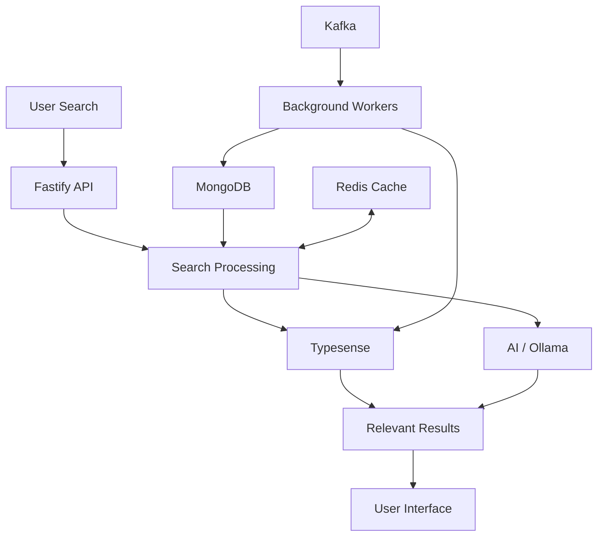

# Multilingual Search

**Search Anything. In Any Language. At Lightning Speed.**

An AI-powered search engine with support for 200+ languages. Search in Hindi, English, Bengali, Hinglish and more. Just type what you're looking for and get fast, relevant results. Search without language barriers!

## What is it?

Multilingual Search helps users find products using the language they are comfortable with. Instead of depending on exact keywords, users can search naturally and discover relevant products quickly.

You can also integrate it into your own project to make search smarter and more accessible.

## Features

* **200+ Languages** – Search across multiple languages.
* **Natural Language Search** – Search the way you speak.
* **AI-Powered Search** – Find relevant results beyond exact keyword matches.
* **Fast Results** – Get search results in milliseconds.
* **Hyperlocal Discovery** – Discover products from nearby stores.
* **Smart Suggestions** – Get helpful search suggestions.

## Tech Stack

| Technology            | Purpose                      |
| --------------------- | ---------------------------- |
| Node.js               | Backend runtime              |
| TypeScript            | Type-safe development        |
| Fastify               | API server                   |
| MongoDB               | Product and application data |
| Redis                 | Caching                      |
| Kafka                 | Event processing             |
| Typesense             | Search engine                |
| Ollama                | Local AI models              |
| HTML, CSS, JavaScript | Frontend                     |

## How It Works



## Project Structure

```text
multilingual-search/
│
├── public/
│   ├── assets/
│   ├── index.html
│   └── admin.html
│
├── src/
│   ├── app.ts
│   ├── routes/
│   ├── services/
│   ├── workers/
│   └── ...
│
├── .env.example
├── package.json
├── pnpm-lock.yaml
├── tsconfig.json
└── README.md
```

## Getting Started

### 1. Clone the repository

```bash
git clone https://github.com/rajesh-kayal-dev/multilingual-search.git

cd multilingual-search
```

### 2. Install dependencies

```bash
pnpm install
```

### 3. Configure environment variables

Create your `.env` file using the example:

```bash
cp .env.example .env
```

Add your MongoDB, Redis, Kafka, Typesense and AI model configuration.

Make sure the required services are running before starting the application.

### 4. Start the project

```bash
pnpm dev
```

Your application should now be running at the configured local port.

## Using It in Your Project

You can connect your application to the search API and send a search query.

Example:

```javascript
const response = await fetch(
  "http://localhost:5004/search/?q=chocolate"
);

const data = await response.json();

console.log(data);
```

Replace the URL with your deployed API URL when using it in production.

## Admin Dashboard

The project also includes an admin dashboard where you can manage and monitor search-related data.

```text
http://localhost:5004/admin
```

API documentation:

```text
http://localhost:5004/api-docs
```

## What's Next?

* Improve multilingual search accuracy.
* Expand language and regional support.
* Improve search relevance and suggestions.
* Make integration easier for developers.

## A Simple Idea

**You shouldn't have to change your language to use technology. Technology should understand yours.**

Search Anything. In Any Language. At Lightning Speed.🖤🩶
